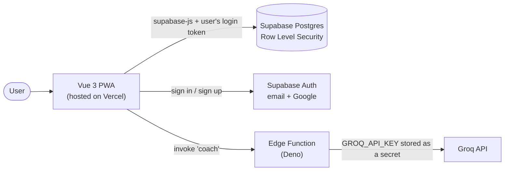

# Remind Me

**A personal productivity app for staying focused on upskilling, job hunting and daily routines.**
Plan tasks, work through them on a Kanban board, run Pomodoro focus sessions, track your streak, and get help from an AI coach. It installs on your phone like a native app.

**Live demo: [remind-me-ivant.vercel.app](https://remind-me-ivant.vercel.app/)**


<!-- Screenshots will be added here once the UI is finalized. -->

## Why I built it

I'm a junior developer who was job hunting and upskilling at the same time, and I kept losing track of what to work on. Existing to-do apps didn't connect tasks to focus time or show whether I was actually being consistent. So I built one, and used it as a chance to practice a full-stack workflow end to end: authentication, a relational database with row-level security, serverless functions, charts, and shipping an installable PWA.

## Features

**Planning**
- **Tasks:** add, edit, complete and delete tasks with notes, a category (upskilling, job hunt, daily) and an optional due date. Filter by category.
- **Kanban board:** drag cards between To Do, Doing and Done, or reorder within a column. Status and order are saved to the database, so they survive a reload.

**Focus and progress**
- **Focus timer:** a 25-minute focus and 5-minute break Pomodoro, optionally linked to a task. Sessions are saved. The countdown keeps running as you move between pages, shows in the header and in the browser tab title, stays accurate in background tabs, and **survives a page refresh**. A chime, vibration and notification announce the end of a session.
- **Dashboard:** current streak, tasks completed this week by category, and a chart of focus hours over the last 7 days, all computed from real data.

**Staying on track**
- **Reminders:** notifications when a task is almost due or overdue, with an on/off switch. Permission is asked for only after you have a task with a due date, never on page load.
- **AI coach:** break a goal into suggested tasks that you review and add in bulk, get a daily plan from your open tasks and due dates, and a short check-in based on your real stats.

**Platform**
- **Auth and profile:** email/password and Google sign-in. Each user can only ever see their own data. Users can set a display name and upload a profile photo (cropped and shrunk in the browser before it is stored).
- **Rewards:** finishing a task fires confetti in the theme colors and a message that adapts to what you just did (first task of the day, 3 and 5 in a day, streak milestones, level-ups). XP and levels are worked out from your tasks and focus time, with no extra tables.
- **Custom design:** a branded light and dark theme (indigo, teal and orange), the Plus Jakarta Sans typeface, color-coded categories, plus six more daisyUI themes and "follow my system".
- **Personalization:** users can pick their own primary, secondary and accent colors (text on buttons adjusts automatically to stay readable) and choose a font from a list or any Google Font by name. Settings sync across devices through the user account.
- **Made for phones:** bottom tab bar with icons, swipeable Kanban columns, press-and-hold to drag on touch screens, and iPhone safe-area spacing.
- **Smooth interactions:** toast messages, loading skeletons, empty states, delete with a 5-second undo, and an `N` keyboard shortcut to add a task.
- **Installable PWA:** add it to your home screen. The app shell is cached so it opens fast.

## Tech stack

| Area | Technology | Used for |
| --- | --- | --- |
| Framework | Vue 3 (Composition API, `<script setup>`) | UI components |
| Build tool | Vite 8 | Dev server and production build |
| Language | JavaScript and TypeScript | Mostly JS, with TypeScript for config, tests and the entry file |
| Routing | Vue Router 5 | Pages and the login guard |
| State | Pinia 4 | Stores for tasks, focus timer, stats, reminders and auth |
| Styling | Tailwind CSS 4 and daisyUI 5 | Layout, components, and the custom brand themes |
| Icons and fonts | Lucide, Fontsource (Plus Jakarta Sans), Google Fonts on demand | Icons, the default typeface, and user-chosen fonts |
| Effects | canvas-confetti | Task-completion celebration |
| Storage | Supabase Storage | Profile photos, with per-user folder policies |
| Database | Supabase (PostgreSQL) | Tasks and focus sessions |
| Auth | Supabase Auth | Email/password and Google OAuth |
| Security | Postgres Row Level Security | Per-user data isolation |
| Serverless | Supabase Edge Functions (Deno) | The AI coach backend |
| AI | Groq API (`openai/gpt-oss-120b`) | Task breakdown, daily plan, check-ins |
| Drag and drop | vue-draggable-plus | Kanban board |
| Charts | Chart.js with vue-chartjs | Focus hours chart |
| PWA | vite-plugin-pwa (Workbox) | Manifest, service worker, installability |
| Testing | Vitest | Unit tests for the business logic |
| Quality | ESLint, oxlint, Prettier, vue-tsc | Linting, formatting and type-checking |
| Hosting | Vercel | Deployment from GitHub |

## Architecture



**Design decisions**

- **Stores own all data access.** Pinia stores are the only code that talks to Supabase. Components call store actions and read state, which keeps the components simple.
- **Business rules are plain functions.** Streak, weekly counts, chart data and reminder selection live in `src/lib` as pure functions with unit tests. They have no Vue or database code, so they are easy to test and read.
- **The database enforces security.** The browser talks to Postgres directly, so every table has Row Level Security. Even if the frontend had a bug, one user could not read another's rows.
- **The AI key never reaches the browser.** The app calls an Edge Function with the user's login token. The function limits the input size, calls Groq, validates the JSON that comes back, and returns only the result. Task ids returned by the model are checked against the real task list.
- **Personalization is layered on the theme.** Custom colors are CSS variables set on the page, so they override the chosen theme and removing them hands control back to it. Settings coming from storage or the account are validated before use, and font names are restricted to plain characters because they end up in a URL and in CSS.
- **Dates use the user's local time zone** for streaks and "this week", so a task finished at 11 pm counts for that day.
- **The timer uses the clock, not ticks.** It stores an end time and compares it to the real clock, so it stays correct when the browser slows down background tabs.
- **Moves feel instant.** Dragging a card updates the screen first and saves to the database in the background. If the save fails, the board reloads from the database and shows an error.

## Data model

| Table | Columns | Notes |
| --- | --- | --- |
| `tasks` | `id`, `user_id`, `title`, `notes`, `category`, `status`, `due_at`, `position`, `completed_at`, `created_at` | `category` is `upskilling`, `job_hunt` or `daily`. `status` is `todo`, `doing` or `done`. `position` orders cards in a column. |
| `focus_sessions` | `id`, `user_id`, `task_id`, `started_at`, `minutes_focused` | `task_id` is optional and is cleared if the task is deleted. Indexed on `(user_id, started_at)`. |

Both tables have a policy that limits every read and write to rows where `user_id = auth.uid()`. The SQL is in [`supabase/`](supabase).

## Project structure

```
src/
├── components/     Reusable UI: app shell and tab bar, task form, task row, toasts, theme picker, reminder banner
├── views/          One file per page: Auth, Tasks, Board, Focus, Dashboard, Coach
├── stores/         Pinia stores (the only code that calls Supabase)
├── lib/            Pure helpers: stats, reminders, dates, theme, Supabase client, AI client
├── router/         Routes and the login guard
├── __tests__/      Unit tests
└── assets/         Tailwind and daisyUI setup
supabase/
├── functions/coach/        Edge Function that calls the AI
├── migrations/             Database migrations
└── reference/tasks.sql     The tasks table, for setting up a fresh project
public/                     PWA icons
```

## Getting started

You need Node 20 or newer and a free [Supabase](https://supabase.com) project.

```sh
git clone https://github.com/AybanFred/remind-me.git
cd remind-me
npm install
cp .env.example .env    # then fill in your own values
npm run dev
```

### Environment variables

| Variable | Where to find it |
| --- | --- |
| `VITE_SUPABASE_URL` | Supabase dashboard, Project Settings, API, Project URL |
| `VITE_SUPABASE_ANON_KEY` | Same page, the `anon` `public` key (safe for the browser because Row Level Security protects the data) |

### Database

In the Supabase SQL Editor, run these in order:

1. `supabase/reference/tasks.sql`
2. `supabase/migrations/20261021000000_focus_sessions.sql`
3. `supabase/migrations/20261022000000_avatars_bucket.sql` (profile photo storage)

### Google sign-in (optional)

1. In Supabase, go to Authentication, Providers, and enable Google with a Google OAuth client.
2. In Google Cloud, set the authorized redirect URI to your Supabase callback: `https://<project-ref>.supabase.co/auth/v1/callback`.
3. In Supabase, go to Authentication, URL Configuration, and add your site URLs to the Redirect URLs (`http://localhost:5173` for development and your deployed domain).

### AI coach (optional)

```sh
npx supabase login
npx supabase link --project-ref <your-project-ref>
npx supabase secrets set GROQ_API_KEY=<your-groq-key>
npx supabase functions deploy coach
```

A free Groq key is available at [console.groq.com](https://console.groq.com). Never put it in `.env` or in a variable starting with `VITE_`, because those are shipped to the browser.

## Scripts

| Command | What it does |
| --- | --- |
| `npm run dev` | Start the dev server |
| `npm run build` | Type-check, then build for production |
| `npm run preview` | Serve the production build locally |
| `npm run test:unit` | Run the unit tests |
| `npm run lint` | Lint and fix |
| `npm run generate-pwa-assets` | Rebuild the PWA icons from `public/icon.svg` |

## Deployment

The app is deployed on Vercel straight from this repository. Every push to `main` redeploys it.

1. Import the repository on Vercel. It detects Vite automatically.
2. Add `VITE_SUPABASE_URL` and `VITE_SUPABASE_ANON_KEY` as environment variables.
3. In Supabase, under Authentication, URL Configuration, set the Site URL to the Vercel domain and add it to the Redirect URLs.

`vercel.json` rewrites all routes to `index.html`, so refreshing a page such as `/board` works.

## Testing

```sh
npm run test:unit
```

The unit tests cover the logic that is easiest to get wrong, including XP and level maths, which celebration to show, readable text colors, and restoring the focus timer after a refresh (still running, finished while away, or paused): streak counting (including a gap in the days and an empty "today"), the Monday week start, per-category weekly counts, 7-day focus totals, and which reminders should fire (including never repeating one and re-firing when a due date changes).

## Known limitations

- **Reminders only fire while the app is open** (in a tab or the installed app). Delivering them when the app is fully closed needs web push, which is not built yet.
- **The timer only counts while the app is open on screen on iPhones,** because iOS pauses background pages. It stays correct when you return, but it cannot alert you with the phone locked.
- **The AI coach uses a free-tier model,** so it has daily limits and its suggestions are helpful but not perfect.
- **Custom fonts need a connection** the first time they are used, since they come from Google Fonts. This sends a request to Google.
- **No offline data.** The app shell loads offline, but tasks need a connection to Supabase.

## Roadmap

- Web push notifications that arrive when the app is closed
- Recurring tasks
- Offline support with sync
- Screenshots and a short demo video in this README
